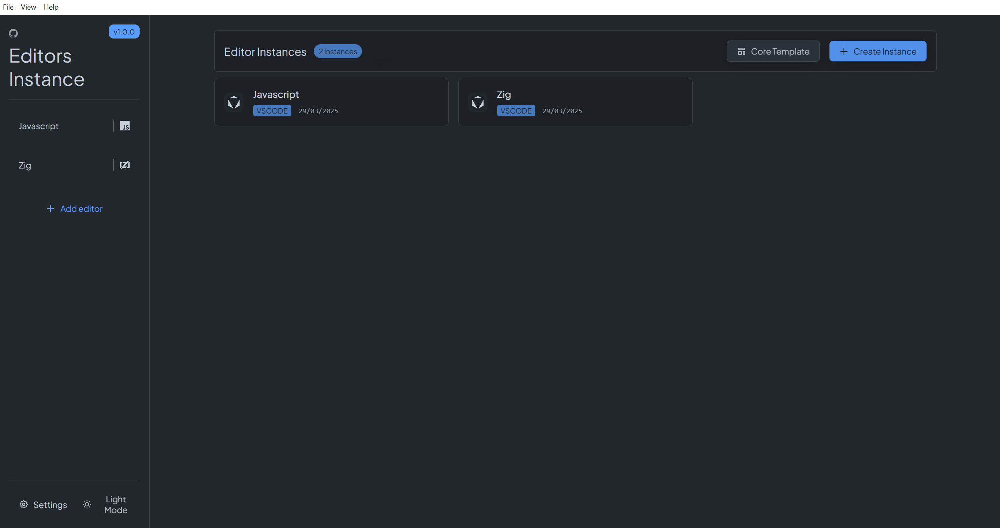
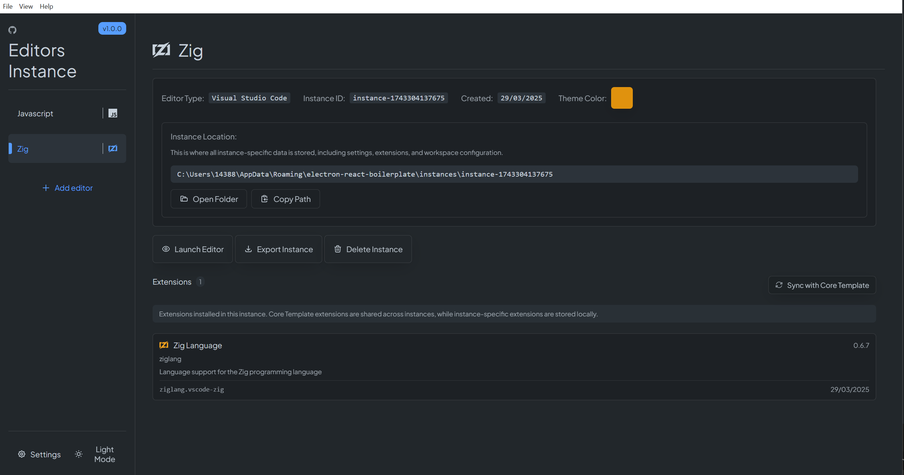

<p align="center">
  
</p>

<h1 align="center">VSCode Instance Manager</h1>

<p align="center">
  Run several isolated VS Code / Cursor instances side by side, each with its own extensions, settings and colour.
</p>

<p align="center">
  <a href="https://github.com/AlexandreBillereau/vsc-instance/actions/workflows/build.yml"></a>
  <a href="LICENSE"></a>
  
</p>

<p align="center">
  
</p>

## Why

One editor profile for every project means dozens of extensions loaded everywhere, slow start-up and settings that fight each other. VSCode Instance Manager gives each stack (JavaScript, Zig, PHP…) its own editor instance, so a Rust toolchain never slows down a front-end project.

## Features

- **Isolated instances**: each one has its own `--user-data-dir` and `--extensions-dir`, so extensions and settings never leak between projects.
- **VS Code and Cursor**: detects installed editors on Windows, macOS and Linux.
- **Core template**: a base set of extensions installed into every new instance.
- **Colour coding**: a name and a title-bar colour per instance, so you always know which window you are in.
- **Import / export**: share an instance as a `.zip` and restore the same setup on another machine.

<p align="center">
  
</p>

## How it works

```
src/
├── main/                         Electron main process
│   ├── main.ts                   IPC handlers (create, open, delete, import/export…)
│   └── features/
│       ├── editor-instances/
│       │   ├── finders/          locate VS Code / Cursor on each OS
│       │   ├── managers/         launch an editor with its own data and extensions dirs
│       │   └── storage/          persist instances, colours, zip import/export
│       └── shared/               paths, names, file-system helpers
└── renderer/                     React UI
```

The renderer never touches the file system: every action goes through a typed IPC channel to the main process.

## Getting started

Requirements: Node.js 20+, and VS Code or Cursor installed.

```bash
git clone https://github.com/AlexandreBillereau/vsc-instance.git
cd vsc-instance
npm install
npm start          # development
npm test           # Jest: renderer smoke test + main-process unit tests
npm run package    # build an installer for the current OS (dmg / exe / deb)
```

CI runs type-checking, tests and a production build on Linux, macOS and Windows for every push.

## Roadmap

- Per-instance extension browser (in progress on `Feature/core-extensions`)
- Signed release builds

## Licence

MIT © Alexandre Billereau
